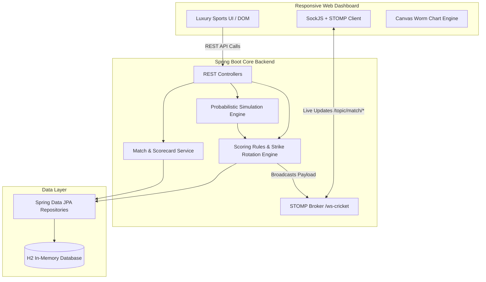

# 🏏 CricketPulse - Scalable & Real-Time Cricket Score Management System

[](https://spring.io/projects/spring-boot)
[](https://www.oracle.com/java/)
[](https://spring.io/guides/gs/messaging-stomp-websocket/)
[](https://www.h2database.com/)
[](LICENSE)

A high-performance, scalable, real-time cricket score management platform built with **Spring Boot** and a responsive **dark-mode dashboard**. The platform provides live ball-by-ball score tracking, automated realistic match simulation, strike-rotation mechanics, dynamic commentary feeds, full official scorecards, over-by-over Worm charts, and a tournament statistics leaderboard.

---

## 🌟 Key Features

1. **🔴 Real-Time Live Scoring Engine**:
   - **STOMP over WebSocket**: Instantaneous broadcast of every delivery, boundary, wicket, and milestone to all connected clients.
   - **Server-Sent Events (SSE) & Polling Fallback**: Automatic failover ensuring zero dropped updates even behind restricted firewalls.

2. **⚡ Probabilistic Cricket Match Simulator**:
   - Dynamic simulation engine modeled after real cricket match phases:
     - **Powerplay (Overs 1-6)**: High boundary frequency and infield exploitation.
     - **Middle Overs (Overs 7-15)**: Strategic strike rotation and singles/doubles.
     - **Death Overs (Overs 16-20)**: High-risk high-reward maximums and increased wicket chances.
   - Accurately simulates:
     - Strike rotation on odd runs (1, 3, 5).
     - End-of-over strike swap and bowler spell rotation.
     - Fall of wickets bringing the next batsman to the crease.
     - Extra deliveries (Wides & No-balls: penalty run + re-bowled delivery; Byes & Leg-byes).
     - Innings transition with target calculation and target chase outcome logic.

3. **🎮 Interactive Scorer Keypad & Simulation Controls**:
   - **Auto-Play Simulation**: Start, Pause, and adjust speeds (0.8s fast, 1.5s normal, 2.5s realistic).
   - **Next Ball (Step)**: Single-click delivery progression for step-by-step review and testing.
   - **Manual Scorer Keypad**: Score custom deliveries off the bat (0, 1, 2, 3, 4, 6), specify Extras, and record Wickets (Bowled, Caught, LBW, Run Out, Stumped) with custom commentary text.
   - **Reset Capability**: Instant one-click match reset back to 0.0 overs.
   - **Custom Match Creator**: Create custom matches with custom teams, tournament names, venues, and overs.

4. **📊 Full Official Two-Innings Scorecard**:
   - Detailed batting table: Runs, Balls, 4s, 6s, Strike Rate, Dismissal description (e.g., `c Maxwell b Cummins`).
   - Detailed bowling table: Overs, Maidens, Runs conceded, Wickets, Economy rate, Dot balls.
   - Extras breakdown: Wides, No-balls, Byes, Leg-byes, and total.

5. **📈 Over-by-Over Worm & Manhattan Chart**:
   - HTML5 Canvas interactive visualization comparing cumulative team progression side-by-side with distinct wicket markers.

6. **💬 Dynamic Ball-by-Ball Commentary Stream**:
   - Real-time generated cricket commentary with contextual flavor text.
   - Quick filters: **All Deliveries**, **Boundaries Only (4s & 6s)**, and **Wickets Only**.

7. **🏆 Player Statistics & Tournament Leaderboard**:
   - Top run-scorers (Orange Cap style with High Score, Strike Rate).
   - Top wicket-takers (Purple Cap style with Economy Rate, Best Figures).
   - Complete Playing XI squad rosters with batting/bowling styles and player roles.

---

## 🏛️ System Architecture



---

## 🚀 Getting Started

### Prerequisites
- **Java 17** or higher
- Git

*(Maven is bundled via the included `./mvnw` wrapper — no separate Maven installation required!)*

### Running the Application

1. **Clone the repository**:
   ```bash
   git clone https://github.com/aniiket777/cricketscore.git
   cd cricketscore
   ```

2. **Run using Maven Wrapper**:
   - On Windows (PowerShell / Command Prompt):
     ```powershell
     .\mvnw.cmd spring-boot:run
     ```
   - On Linux / macOS:
     ```bash
     ./mvnw spring-boot:run
     ```

3. **Open the Dashboard**:
   - Navigate to: **[http://localhost:8080](http://localhost:8080)** in any modern web browser.
   - H2 Database Console: **[http://localhost:8080/h2-console](http://localhost:8080/h2-console)**
     - JDBC URL: `jdbc:h2:mem:cricketdb`
     - Username: `sa`
     - Password: *(leave blank)*

---

## 📡 REST API Reference

| Method | Endpoint | Description |
|---|---|---|
| `GET` | `/api/matches` | List all matches (optional filter `?status=LIVE`) |
| `GET` | `/api/matches/{id}` | Get full details of a specific match |
| `GET` | `/api/matches/{id}/scorecard` | Get official 2-innings detailed scorecard |
| `GET` | `/api/matches/{id}/commentary?limit=30` | Get recent ball-by-ball commentary |
| `GET` | `/api/matches/{id}/worm` | Over-by-over Worm chart data points |
| `POST` | `/api/matches` | Create a new match |
| `GET` | `/api/matches/{id}/stream` | Server-Sent Events (SSE) live updates stream |
| `POST` | `/api/simulation/start/{matchId}?intervalMs=1500` | Start automated live ball-by-ball simulation |
| `POST` | `/api/simulation/pause/{matchId}` | Pause ongoing simulation |
| `POST` | `/api/simulation/step/{matchId}` | Simulate exactly 1 ball delivery |
| `POST` | `/api/simulation/speed/{matchId}?intervalMs=800` | Change simulation delivery interval |
| `POST` | `/api/simulation/reset/{matchId}` | Reset match to 0.0 overs |
| `GET` | `/api/simulation/status/{matchId}` | Check if simulation is actively running |
| `POST` | `/api/scorer/matches/{matchId}/ball` | Manually record a ball event with custom runs/wicket/commentary |
| `GET` | `/api/stats/leaderboard` | Tournament top run scorers & wicket takers |
| `GET` | `/api/stats/teams` | List all teams |
| `GET` | `/api/stats/teams/{id}/players` | List full squad roster of a team |
| `GET` | `/api/stats/overview` | System health and summary metrics |

---

## 🧪 Testing

Run automated unit and integration tests:
```powershell
.\mvnw.cmd test
```

---

## 📂 Project Structure

```
Cricket_live Score/
├── .mvn/wrapper/               # Maven wrapper binaries
├── src/
│   ├── main/
│   │   ├── java/com/cricket/score/
│   │   │   ├── controller/     # Match, Scorer, Simulation & Stats REST APIs
│   │   │   ├── dto/            # Scorecard, BallEvent, Worm & Match DTOs
│   │   │   ├── model/          # JPA Entities (Match, Team, Player, Innings, etc.)
│   │   │   ├── repository/     # Spring Data JPA Repositories
│   │   │   ├── service/        # ScoringEngine, SimulationEngine, MatchService
│   │   │   ├── websocket/      # STOMP Broker Configuration
│   │   │   └── CricketscoreApplication.java
│   │   └── resources/
│   │       ├── application.properties
│   │       └── static/         # Responsive Real-Time Web Dashboard
│   │           ├── css/style.css
│   │           ├── js/app.js
│   │           └── index.html
│   └── test/                   # Unit & context integration tests
├── mvnw & mvnw.cmd             # Maven wrapper scripts
├── pom.xml                     # Maven project descriptor & dependencies
└── README.md
```

---

## 👨‍💻 Author & Assignment Information

- **Repository**: [https://github.com/aniiket777/cricketscore.git](https://github.com/aniiket777/cricketscore.git)
- Built with ❤️ using **Spring Boot**, **Java 17**, and modern Web standards.
